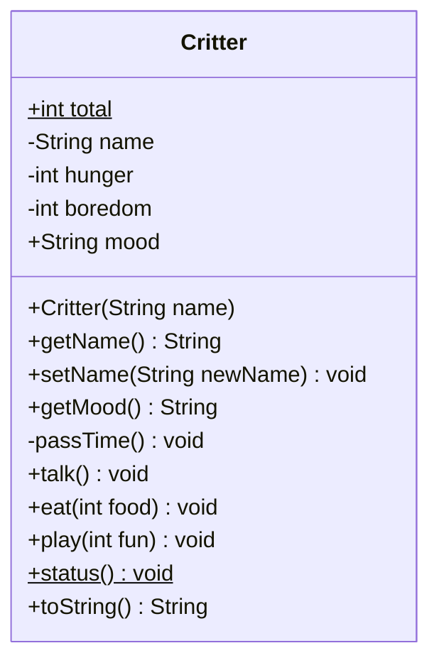

# UML Class Diagram — `Critter`

Based on `critter.py` — the **starting** class, before any of the extension stages in
`README.md`. Redrawing this diagram after a stage is one of the better ways to check you
understood what you changed.

Python doesn't declare types. UML does. So when we draw a Python class in UML we
*read the types off the code* — what does `__init__` actually put in the box?
That inference is half the exercise.

---

## The diagram

```
┌──────────────────────────────────────────────────┐
│                     Critter                      │
├──────────────────────────────────────────────────┤
│ + total: int              {static}               │
│ - name: String                                   │
│ - hunger: int                                    │
│ - boredom: int                                   │
│ + /mood: String           {readOnly, derived}    │
├──────────────────────────────────────────────────┤
│ + «constructor» Critter(name: String)            │
│ + getName(): String                              │
│ + setName(newName: String): void                 │
│ + getMood(): String                              │
│ - passTime(): void                               │
│ + talk(): void                                   │
│ + eat(food: int = 4): void                       │
│ + play(fun: int = 4): void                       │
│ + status(): void          {static}               │
│ + toString(): String                             │
└──────────────────────────────────────────────────┘
```

Three compartments, always in this order:

1. **Name** — the class name, centred.
2. **Attributes** — the data each object carries.
3. **Operations** — the methods, what the object can *do*.

---

## Same diagram, Mermaid version



(`$` is Mermaid's marker for static members — in hand-drawn UML you
<u>underline</u> them instead.)

---

## Notation you need to know

| Symbol | Means | In this class |
|---|---|---|
| `+` | public — anyone can touch it | `talk()`, `total` |
| `-` | private — only the class itself | `name`, `hunger`, `boredom`, `passTime()` |
| `#` | protected — the class and its subclasses | *(none here)* |
| <u>underline</u> / `{static}` | belongs to the **class**, not to any one object | `total`, `status()` |
| `/` before a name | **derived** — computed, not stored | `/mood` |
| `«constructor»` | stereotype: labels what kind of thing this is | `Critter(name)` |
| `name: Type` | attribute and its type | `hunger: int` |
| `method(): Type` | the return type; `void` means returns nothing | `getMood(): String` |

---

## Reading the Python back into the diagram

| Python (`critter.py`) | UML line | Why |
|---|---|---|
| `total = 0` | `+ total: int {static}` | Defined on the class body, shared by every critter. Underlined. |
| `self._name = name` | `- name: String` | Leading underscore ⇒ private ⇒ `-`. The value came from a `str`, so `String`. |
| `self._hunger = 0` | `- hunger: int` | Initialised to `0`, an integer. |
| `def __init__(self, name)` | `+ «constructor» Critter(name: String)` | UML names the constructor after the class. `self` is never shown. |
| `@property def name` | `+ getName(): String` | A property *is* a getter — UML has no `@property`, so draw the method. |
| `@name.setter def name` | `+ setName(newName: String): void` | Sets state, returns nothing ⇒ `void`. |
| `@property def mood` | `+ /mood: String` + `+ getMood(): String` | Nothing stores mood; it's recomputed from `hunger + boredom`. That's a *derived* attribute. |
| `def _pass_time(self)` | `- passTime(): void` | Private helper. The class uses it; the player never calls it. |
| `def eat(self, food=4)` | `+ eat(food: int = 4): void` | Default values are allowed in UML — write them after `=`. |
| `@staticmethod def status()` | `+ status(): void {static}` | No `self` ⇒ no object needed ⇒ static. Underlined. |
| `def __repr__(self)` | `+ toString(): String` | UML's conventional name for "describe me as text". See the note below. |

---

## Discussion questions

1. `mood` has no `self._mood` anywhere in the file. Why is it still drawn in the
   attributes compartment — and why with a `/`?
2. `total` is public (`+`) while `hunger` is private (`-`). What would go wrong if
   we made `hunger` public?
3. `eat()` and `play()` both call `passTime()`. UML doesn't show that. Which
   diagram *would*?
4. `self` appears in every Python method signature and in none of the UML ones.
   Where did it go?
5. If we added a `Dog` class that `Critter` inherits from, what changes on this
   diagram?

---

## A note on `toString()`, for when you reach Stage 6

UML has **one** operation for "describe me as a string": `+ toString(): String`. Python has
**two** methods that do it, for two different readers:

| Python | Who it is for | In this diagram |
|---|---|---|
| `__repr__` | the programmer — exact state, shown in the REPL | `+ toString(): String` |
| `__str__` | the player — prose, shown by `print()` | *not here yet — Stage 6 adds it* |

The starting class has only `__repr__`, so there is only one `toString()` in the box above.
Once Stage 6 adds `__str__`, the class has two string operations and one UML name between
them. The usual fix is to draw both and say which is which:

```
│ + toString(): String                             │
│ + toDisplayString(): String                      │
```

…or to draw the one the *assessment* is asking about and name it in a comment. Either is
defensible. What is not defensible is drawing one box and pretending the other method isn't
there.

This is a real and ordinary thing about modelling: **the diagram is a different language from
the code, and sometimes the languages do not divide the world the same way.** Noticing where
the mapping stops being one-to-one is the skill being assessed, not a sign you drew it wrong.

## And one on `introduce`, for Stage 7

```
│ + introduce(other: Critter): void                │
```

An operation whose **parameter type is its own class**. That is ordinary and common, and it is also
the first point in this diagram where `Critter` refers to `Critter`. In a fuller model you would draw
that as an *association* — a line from the class back to itself — rather than leaving it buried in a
parameter list.

Note what is *not* underlined. `introduce` needs a particular critter to be the one doing the
introducing, so it is an instance operation. `status()` needs no critter at all, so it stays
`{static}`. One class, both kinds, and the diagram shows the difference at a glance.
